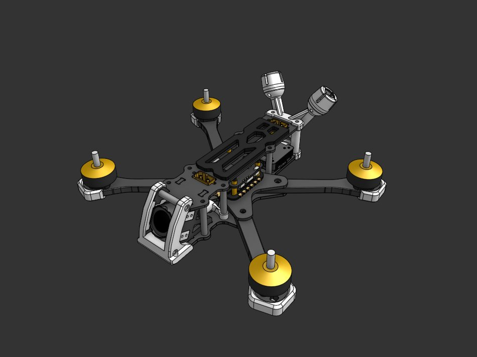
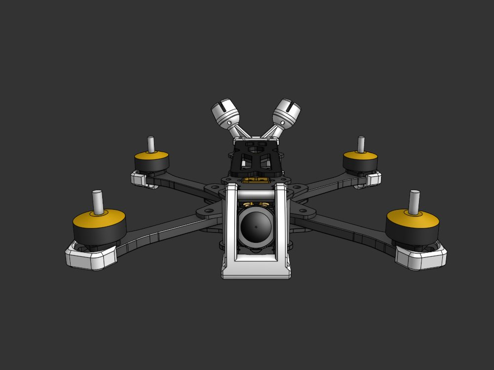
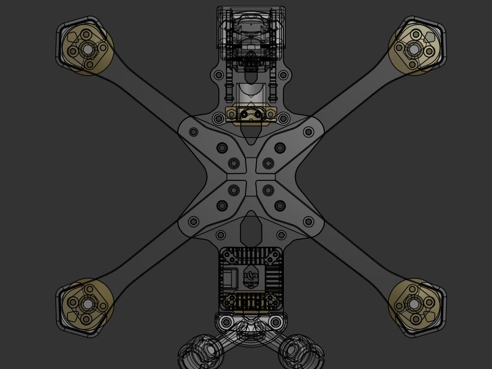
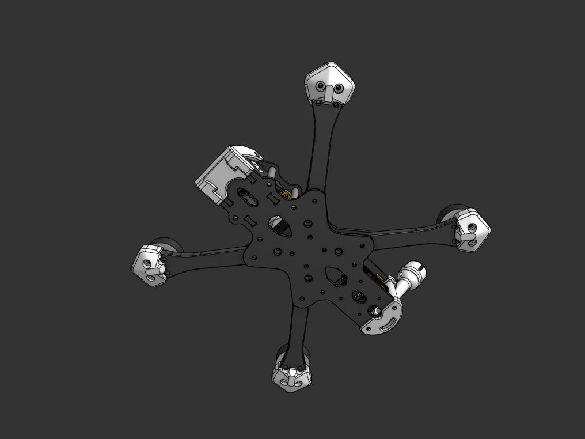

# Nova 5"

### 5" Freestyle FPV Frame

The **Nova 5** is a **218 mm wheelbase freestyle frame** built for agile, hard-hitting 5-inch flying. Thick 6 mm arms are sandwiched between a rounded bottom and center plate for crash resistance, and a keystone layout keeps the frame stiff and quiet. Native DJI O4 Pro support, front or rear XT60 and stack screws you can reach without tearing the frame apart make it easy to build and easy to maintain.

> ⚠️ **Beta notice (v0.9):** This release has **not been milled or flight tested yet**. The files are published for early feedback. Expect changes before v1.0. If you mill one, please share your results and open an issue for anything that doesn't fit.

  
  

  
  

---

## ✨ Features
- **218 mm wheelbase** for high agility
- **squished X** for high freestyle performance and less props in view
- **Fits 4.9" to 5.1" props**
- **6 mm arms** sandwiched between a **rounded bottom and center plate** for better crash resistance
- **Long arm reach** into the plates for better vibrational performance
- **Keystone design** for improved rigidity and vibrational performance
- **25° fixed camera angle**
- **DJI O4 Pro native:** camera mounting holes, VTX mounting holes and TPU antenna mount
- **Front and rear XT60 options** (fixed mount or pass-through)
- **Stack screws reachable without disassembling the frame**
- **Press nut holes** for stack and arms
- **30.5 × 30.5 mm stack mounting**
- **Matching TPU parts** included
- **Step file** for your customization needs
- **30mm standoffs** for a spacious build and great sbang performance
- **2x 20mm standoffs** for an extremely rigid camera cage
- **Stack height:** 21.5mm

---

## 🛒 Buy the Frame

The design is free and open source, so you can have it made by any CNC milling service.

**CNCDrones:** coming after v1.0 testing

---

## 🔧 Build Specifications & Recommendations

### **Frame Thickness**
| Part | Thickness |
|---|---|
| Arms | 6 mm |
| Bottom plate | 3 mm |
| Center plate | 3 mm |
| Camera plates | 3 mm |
| Top plate | 2.5 mm |

### **Motor Recommendations**
- **2207 or 2306 motors** with a **16 × 16 mm** bolt pattern, 4 × M3
- Kv range:
  - **6S builds:** 1700-2100 Kv
  - **4S builds:** 2400-2750 Kv

### **Propeller Size**
- **4.9", 5" and 5.1" propellers**

### **Flight Controller / Stack**
- **30.5 × 30.5 mm** stack
- Recommended FC CPU: **F405, F722, H745**
- Recommended ESC current: **min. 45A**

### **Video System**
- **DJI O4 Pro** (native 20mm mounting)

### **Radio Link**
- **ELRS** or **Crossfire**

### **Optional**
- GPS
- Buzzer

### **Screw Sizes**
- **Motor screws:** M3 × 6-8 mm (6 mm arms, check thread depth of your motor)
- **Stack mounting:** M3 into press nuts
- **Arm mounting:** M3 into press nuts

### **3D Print Recommendations**
Material: **TPU (95A)**
Included prints:
- Camera protection / front mount
- Arm guards / motor bumpers
- DJI O4 Pro antenna mount
- XT60 mount

---

## 🏗️ Build Tips
- Press the nuts in before mounting arms and stack, a drop of thread locker on the arm screws helps
- Choose front or rear XT60 before routing power leads, keep the battery lead short
- Stack screws can be serviced from outside, no need to strip the frame for a stack swap
- Keep the battery centered for better CG
- Keep wiring short and tidy for better performance and reliability

---

## 🔗 Printables Link

👉 **Printables:** coming soon

---

## 🪐 Saturn FPV Frames

**Nova Series**
- [Nova 5](https://github.com/saturn-fpv/Nova-5) - 218 mm wheelbase, 5" props, 6 mm arms (v0.9 beta)

**Mars Series**
- [Mars 2](https://github.com/saturn-fpv/Mars-2) - 90 mm wheelbase, 2" props, 2 mm carbon
- [Mars 3](https://github.com/saturn-fpv/Mars-3) - 120 mm wheelbase, 3" props, 2.5 mm carbon
- [Mars 4](https://github.com/saturn-fpv/Mars-4) - 160 mm wheelbase, 4" props, 3 mm carbon
